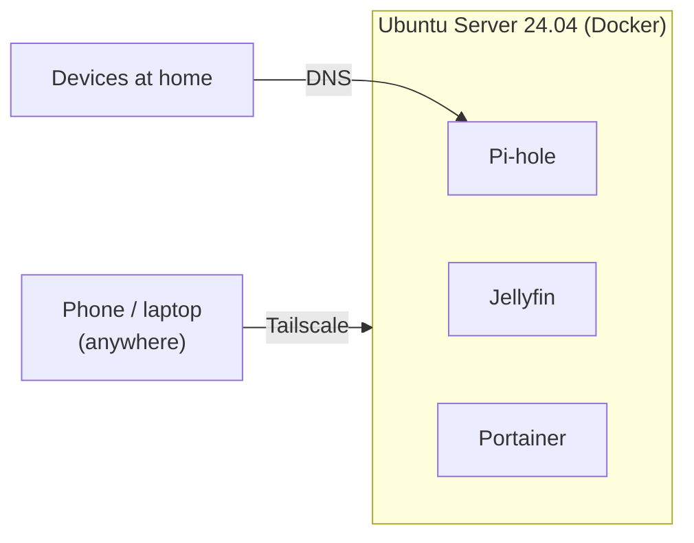

# my-homelab

An old Acer laptop running Ubuntu Server 24.04 with no screen attached. It sits at home and runs a few services in Docker. I manage it over SSH. I set it up to get better at Linux, Docker and networking, and these are my notes from doing that.



| Service | Used for | Port |
| --- | --- | --- |
| [Pi-hole](https://pi-hole.net) | Blocks ads and trackers for the whole network at the DNS level | 53, admin on 8080 |
| [Jellyfin](https://jellyfin.org) | Plays my own films, shows and music | 8096 |
| [Portainer](https://www.portainer.io) | Web UI for containers and logs | 9443 |
| [Tailscale](https://tailscale.com) | Lets me reach the server from outside without opening router ports | installed on the host |

## Setup

```sh
git clone https://github.com/Schaulagain/my-homelab.git && cd my-homelab
cp .env.example .env   # passwords, timezone, path to media
docker compose up -d
```

Everything the containers save goes into `./data/`, which is git-ignored. If the laptop dies, this repo plus a copy of that folder is enough to bring it all back.

## Notes

1. [Installing Ubuntu Server and Docker](./docs/01-initial-setup.md)
2. [Pi-hole](./docs/02-pihole.md)
3. [Jellyfin and Portainer](./docs/03-jellyfin-portainer.md)
4. [Tailscale](./docs/04-tailscale.md)

## Next

- [ ] Back up `./data/` to an external drive on a schedule
- [ ] Uptime Kuma for monitoring
- [ ] A reverse proxy with HTTPS so I don't have to remember port numbers
- [ ] Use Pi-hole as the DNS server over Tailscale too
