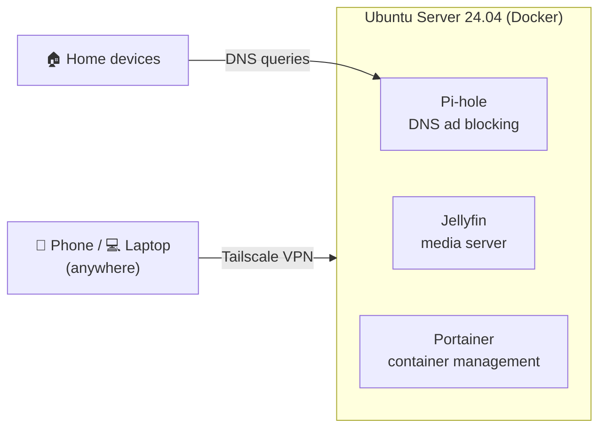

# My Homelab Journey 🚀

An old laptop turned into a headless Ubuntu server that runs my self-hosted services in Docker. This repository documents how I built it to learn Linux administration, containers and networking hands-on.



## Services

| Service | What it does | Port |
| --- | --- | --- |
| [Pi-hole](https://pi-hole.net) | Network-wide ad and tracker blocking through DNS | 53 (DNS), 8080 (admin) |
| [Jellyfin](https://jellyfin.org) | Streams my own movies, shows and music | 8096 |
| [Portainer](https://www.portainer.io) | Web UI to manage containers, images and logs | 9443 |
| [Tailscale](https://tailscale.com) | Private VPN for remote access, with no router ports opened | runs on the host |

## Hardware
* **Server:** Toshiba Equium L40 (Pentium Dual, 3GB RAM, 250GB HDD)
* **OS:** Ubuntu Server 24.04 LTS, headless, managed over SSH

## Quick start

```sh
git clone https://github.com/Schaulagain/my-homelab.git && cd my-homelab
cp .env.example .env   # set passwords, timezone and media path
docker compose up -d
```

All service data lives in `./data/` (git-ignored), so the lab can be rebuilt from this repo plus that one folder.

## Documentation
1. [Initial Server Setup & Docker Install](./docs/01-initial-setup.md)
2. [Network-wide Ad Blocking with Pi-hole](./docs/02-pihole.md)
3. [Media Server and Container Management](./docs/03-jellyfin-portainer.md)
4. [Remote Access with Tailscale](./docs/04-tailscale.md)

## Roadmap
- [ ] Automated backups of `./data/` to an external drive
- [ ] Uptime monitoring with Uptime Kuma
- [ ] Reverse proxy with HTTPS for friendly service URLs
- [ ] Use Pi-hole as the DNS server for the whole tailnet
